<!-- 灵感与部分脚本来自 ouuan (https://github.com/ouuan/ouuan)，Apache-2.0，署名见 LICENSE 与 src/getTopFollowers.py -->

<p align="center">
  
</p>

<p align="center">
  I'm a beginner programmer :rocket: 在代码的宇宙里慢慢探索
</p>

<p align="center"></p>

### :milky_way: 技术星系

<p align="center">
  
</p>

<p align="center">
  
</p>

-   :package: [Arch Linux (AUR)](https://aur.archlinux.org/packages?K=sunflowercx&SeB=m)
-   :star: [Projects starred by me](AWESOME-STARS.md)

<p align="center"></p>

### :snake: Activity // 贪吃蛇

<p align="center">
  
</p>

<p align="center"></p>

### :sparkles: [My followers](src/getTopFollowers.py)

<!--START_SECTION:top-followers-->
<table>
  <tr>
    <td align="center">
      <a href="https://github.com/kpopdev">
        
      </a>
      <br />
      <a href="https://github.com/kpopdev">Kyla</a>
    </td>
    <td align="center">
      <a href="https://github.com/tomellis712">
        
      </a>
      <br />
      <a href="https://github.com/tomellis712">Tom</a>
    </td>
    <td align="center">
      <a href="https://github.com/GREEDY20NINE">
        
      </a>
      <br />
      <a href="https://github.com/GREEDY20NINE">GREEDY20NINE</a>
    </td>
  </tr>
</table>
<!--END_SECTION:top-followers-->

<p align="center"></p>

### :bar_chart: [Coding time](https://github.com/muety/wakapi)

<p align="center">
  
</p>

<details>
<summary>纯文本版</summary>

<!--START_SECTION:waka-->

```txt
Kotlin                 315 hrs               🟩🟩🟩🟩🟩🟩🟩🟩🟩🟩🟩🟩🟩🟨⬜⬜⬜⬜⬜⬜⬜⬜⬜⬜⬜   53.41 %
C++                    61 hrs 25 mins        🟩🟩🟨⬜⬜⬜⬜⬜⬜⬜⬜⬜⬜⬜⬜⬜⬜⬜⬜⬜⬜⬜⬜⬜⬜   10.41 %
Markdown               50 hrs 31 mins        🟩🟩⬜⬜⬜⬜⬜⬜⬜⬜⬜⬜⬜⬜⬜⬜⬜⬜⬜⬜⬜⬜⬜⬜⬜   08.57 %
Python                 24 hrs 58 mins        🟩⬜⬜⬜⬜⬜⬜⬜⬜⬜⬜⬜⬜⬜⬜⬜⬜⬜⬜⬜⬜⬜⬜⬜⬜   04.23 %
XML                    23 hrs 41 mins        🟩⬜⬜⬜⬜⬜⬜⬜⬜⬜⬜⬜⬜⬜⬜⬜⬜⬜⬜⬜⬜⬜⬜⬜⬜   04.02 %
```

<!--END_SECTION:waka-->

</details>

<p align="center">
  
</p>