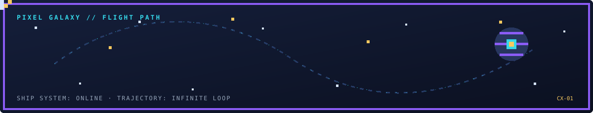
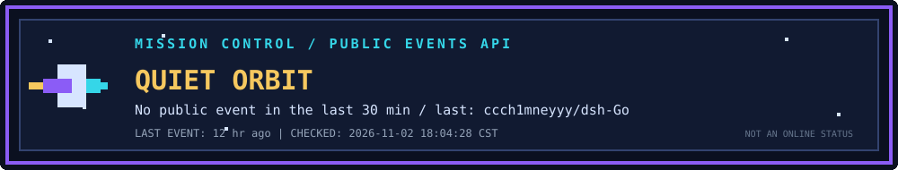
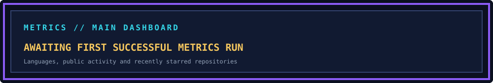
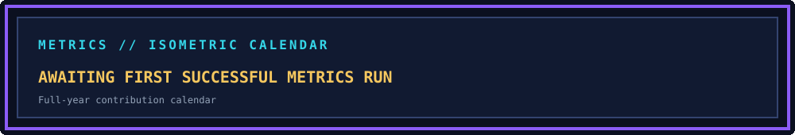
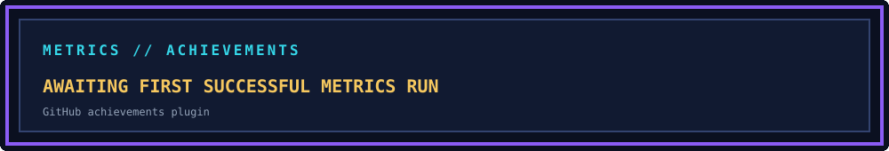
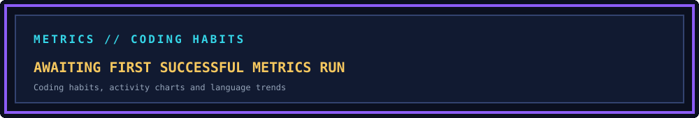

<div align="center">
  
  <br/>
  
  
  
</div>

---

## ▣ MISSION CONTROL

<div align="center">
  
  <br/>
  
</div>

> **Activity signal ≠ online status.** The status panel checks public GitHub events on an approximately 15-minute schedule and marks activity observed within the last 30 minutes. GitHub documents that public-event data can be delayed from around 30 seconds to as much as 6 hours, so this is only an approximate public-activity signal, never a claim that I am currently online.

## ▣ PLAYER PROFILE

<table>
  <tr>
    <td width="56%" valign="top">
      <p><b>PLAYER:</b> cxsunflower</p>
      <p>Beginner programmer :smiley:</p>
      <p>Exploring code, open source, and the occasional side quest.</p>
      <ul>
        <li>:seedling: Always learning and coding</li>
        <li>:package: <a href="https://aur.archlinux.org/packages?K=sunflowercx&SeB=m">Arch Linux (AUR)</a></li>
        <li>:mag: <a href="CVE.md">CVEs discovered by me</a></li>
        <li>:star: <a href="AWESOME-STARS.md">Projects starred by me</a></li>
      </ul>
    </td>
    <td width="44%" valign="top" align="center">
      
    </td>
  </tr>
</table>

## ▣ PIXEL GALAXY SYSTEMS

| Module | Implementation | Refresh |
|---|---|---|
| Dynamic spaceship | Custom pixel SVG + animated flight path | Continuous |
| Activity signal | GitHub Public Events API | About every 15 minutes |
| Metrics main panel | <code>lowlighter/metrics</code> | Daily |
| Isometric contribution calendar | Metrics Isocalendar plugin | Daily |
| GitHub achievements | Metrics Achievements plugin | Daily |
| Coding habits and languages | Metrics Habits + Languages plugins | Daily |
| Contribution snake | <code>Platane/snk</code> animated SVG | Daily |
| Coding time | Existing WakaTime / Wakapi workflow | Preserved |

## ▣ METRICS // MAIN DASHBOARD

<p align="center">
  
</p>

## ▣ ISOMETRIC CONTRIBUTION MAP

<p align="center">
  
</p>

## ▣ GITHUB ACHIEVEMENTS

<p align="center">
  
</p>

## ▣ CODING HABITS

<p align="center">
  
</p>

## ▣ CONTRIBUTION SNAKE

<p align="center">
  <picture>
    <source media="(prefers-color-scheme: dark)" srcset="https://raw.githubusercontent.com/cxsunflower/cxsunflower/output/github-snake-dark.svg" />
    <source media="(prefers-color-scheme: light)" srcset="https://raw.githubusercontent.com/cxsunflower/cxsunflower/output/github-snake.svg" />
    
  </picture>
</p>

## ▣ TECH LOADOUT

<p>
  
  
  
  
  
  
</p>

## ▣ CODING TIME // WAKATIME / WAKAPI

<!--START_SECTION:waka-->

```txt
Kotlin                 315 hrs               🟩🟩🟩🟩🟩🟩🟩🟩🟩🟩🟩🟩🟩🟨⬜⬜⬜⬜⬜⬜⬜⬜⬜⬜⬜   53.41 %
C++                    61 hrs 25 mins        🟩🟩🟨⬜⬜⬜⬜⬜⬜⬜⬜⬜⬜⬜⬜⬜⬜⬜⬜⬜⬜⬜⬜⬜⬜   10.41 %
Markdown               50 hrs 31 mins        🟩🟩⬜⬜⬜⬜⬜⬜⬜⬜⬜⬜⬜⬜⬜⬜⬜⬜⬜⬜⬜⬜⬜⬜⬜   08.57 %
Python                 24 hrs 58 mins        🟩⬜⬜⬜⬜⬜⬜⬜⬜⬜⬜⬜⬜⬜⬜⬜⬜⬜⬜⬜⬜⬜⬜⬜⬜   04.23 %
XML                    23 hrs 41 mins        🟩⬜⬜⬜⬜⬜⬜⬜⬜⬜⬜⬜⬜⬜⬜⬜⬜⬜⬜⬜⬜⬜⬜⬜⬜   04.02 %
```

<!--END_SECTION:waka-->

## ▣ COMMUNITY // TOP FOLLOWERS

<!--START_SECTION:top-followers-->
<table>
  <tr>
    <td align="center">
      <a href="https://github.com/kpopdev">
        
      </a>
      <br/>
      <a href="https://github.com/kpopdev">Kyla</a>
    </td>
    <td align="center">
      <a href="https://github.com/tomellis712">
        
      </a>
      <br/>
      <a href="https://github.com/tomellis712">Tom</a>
    </td>
    <td align="center">
      <a href="https://github.com/GREEDY20NINE">
        
      </a>
      <br/>
      <a href="https://github.com/GREEDY20NINE">GREEDY20NINE</a>
    </td>
  </tr>
</table>
<!--END_SECTION:top-followers-->

---

<div align="center">
  <code>[ END OF README ]</code>
  <br/>
  <sub>Built one pixel at a time · cxsunflower</sub>
  <br/>
  <sub>Metrics first render requires the repository Actions secret <code>METRICS_TOKEN</code>. See <a href="DEPLOYMENT.md">deployment notes</a>.</sub>
</div>
