<!-- 灵感与部分脚本来自 ouuan (https://github.com/ouuan/ouuan)，Apache-2.0，署名见 LICENSE 与 src/getTopFollowers.py -->

  

  

  
  &nbsp;&nbsp;
  

  

  

  

<!--START_SECTION:top-followers-->
<table>
  <tr>
    <td align="center">
      
       
      <a href="https://github.com/kpopdev">Kyla</a>
    </td>
    <td align="center">
      
       
      <a href="https://github.com/tomellis712">Tom</a>
    </td>
    <td align="center">
      
       
      <a href="https://github.com/GREEDY20NINE">GREEDY20NINE</a>
    </td>
  </tr>
</table>
<!--END_SECTION:top-followers-->

  

  

